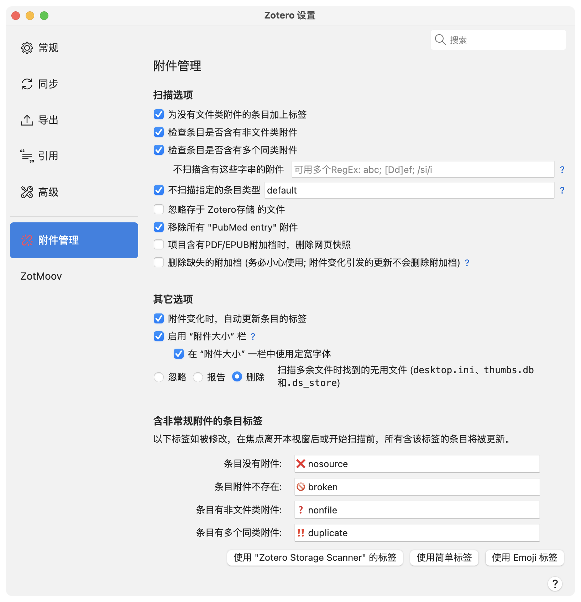

附件扫描器设置
=======

[English ](preference_help.md) | [繁體中文](preference_help.zh-TW.md) | **简体中文**

扫描选项
-------
启用或禁用特定功能。

### 为没有文件类附件的条目加上标签
启用后，即使条目包含非文件附件，只要没有文件附件，插件就会为其添加“无附件”标签。

### 检查条目是否含有非文件类附件
启用后，插件会为包含非文件附件的条目添加“非文件附件”标签。Zotero 条目可以包含保存元数据的非文件附件。

### 检查条目是否含有多个同类附件
启用后，如果一个条目包含两个或以上具有相同内容类型（content type）的附件，插件会为其添加“重复附件”标签。内容类型类似于 MIME type，主要由文件扩展名决定。例如，包含两个 PDF 附件的条目会被视为存在重复附件；而同时包含一个 PDF 和一个 .xlsx 附件的条目则不会。

#### 不扫描含有这些字串的附件
文件名匹配这些规则的附件将在重复附件检查时被忽略。多个规则请使用分号（`;`）分隔。程序会自动去除首尾空格并转换为正则表达式（RegEx）。

示例：
- `abc; [dD]ef`：匹配包含“abc”、“def”或“Def”的文件名，区分大小写。
- `abc/i; def`：匹配包含“abc”（不区分大小写）或“def”（区分大小写）的文件名。
- `/ abc; def`：匹配包含“ abc”或“def”的文件名，区分大小写。

### 不扫描指定的条目类型
每个 Zotero 条目都有一个关联的项目类型（item type）。某些项目类型可能包含 URL，但没有附件。本字段用于指定在检查时排除的项目类型，以逗号分隔。

如果未设置，则默认为 `default`，对应：
- `annotation, attachment, note, blogPost, computerProgram, email, forumPost, instantMessage, podcast, radioBroadcast, tvBroadcast, webpage`

请使用 Zotero 的内部项目类型名称，并且不要包含空格。更多信息请参阅 Zotero 官方文档。
- 一般不建议排除：`book`, `bookSection`, `conferencePaper`, `document`, `journalArticle`, `manuscript`, `preprint`, `report`, `standard`, `thesis`
- 可以排除，但通常不建议排除：`bill`, `case`, `dictionaryEntry`, `encyclopediaArticle`, `hearing`, `interview`, `letter`, `magazineArticle`, `newspaperArticle`, `patent`, `statute`
- Zotero 内部使用的类型：`annotation`, `attachment`, `note`
- 通常关联本地或外部数据的类型：`artwork`, `audioRecording`, `dataset`, `film`, `map`, `presentation`, `videoRecording`
- 通常关联在线内容的类型：`blogPost`, `computerProgram`, `email`, `forumPost`, `instantMessage`, `podcast`, `radioBroadcast`, `tvBroadcast`, `webpage`

示例：
- `default`：不检查 Zotero 内部使用的项目类型以及通常关联在线内容的项目类型。
- `webpage, dictionaryEntry`：不检查引用网页或词典条目的项目。

### 忽略存于 Zotero存储 的文件
Zotero Storage 中的部分附件采用按需下载方式，从云端存储获取。启用此选项后，这些附件不会因尚未下载而被标记为损坏附件。

### 移除所有 "PubMed entry" 附件
启用后，插件会删除所有名称为“PubMed entry”的非文件附件。这类附件通常由 Zotero 在导入 PubMed 或部分期刊文献时自动创建。

### 项目含有PDF/EPUB附加档时，删除网页快照
从网页创建条目时，即使检测到 PDF 文件，Zotero 仍可能根据“常规”设置自动保存网页快照。启用此选项后，插件会删除包含 PDF 附件条目中的网页快照。

### 删除缺失的附加档
启用后，条目中的缺失附件将被删除。此操作不会对文件系统中的实际文件进行任何修改。

> [!CAUTION]
> 虽然“删除缺失附件”功能不会删除任何文件，并且损坏的附件仍可从回收站恢复，但如果文件同步落后于文库同步，可能会导致严重问题。 
> 此选项会在每次启动 Zotero 时自动重置。

其他选项
-------

### 附件变化时，自动更新条目的标签
启用后，每当条目或附件被添加到文库或从文库中删除时，插件都会自动执行所有已启用的检查项目，但不包括“删除缺失附件”。

### 启用 “附件大小” 栏
启用后（默认开启），“附件大小”列可用于查看和按附件大小排序条目。由于这些信息不会保存在数据库中，而是需要实时从磁盘读取，因此关闭此功能可以减少不必要的磁盘访问。

如果不需要该列，建议关闭此功能。特别是因为 Zotero 会加载所有列的数据，即使该列当前未显示。

#### 在 “附件大小” 一栏中使用定宽字体
项目列表默认使用比例字体显示，这会导致数字无法对齐，不利于比较。启用此选项后，“附件大小”列将使用等宽字体（monospace），以提高可读性和对齐效果。

### 忽略／报告／删除无用文件
扫描“附件根目录”时，插件会查找未与任何 Zotero 条目关联的孤立文件（orphan files）。对于这些垃圾文件，插件可以选择：
- 忽略；
- 将其列入孤立文件报告；
- 直接从文件系统删除。

含非常规附件的条目标签
-------

用于自定义标签名称。修改标签后，当设置窗口失去焦点或执行新的扫描时，现有项目中的旧标签会自动更新为新的标签。

点击下方三个按钮之一可使用预设标签。

|                       | “Zotero Storage Scanner” 标签      | 简单标签    | Emoji 标签   |
| --------------------: | ---------------------------------- | ----------- | ------------ |
| 无附件               | #nosource                          | #nosource   | ❌ nosource  |
| 缺失附件             | #broken_attachments                | #broken     | 🚫 broken    |
| 非文件附件           | #non_file_attachments              | #nonfile    | ❓ nonfile   |
| 重复附件             | #multiple_attachments_of_same_type | #duplicate  | ‼️ duplicate |