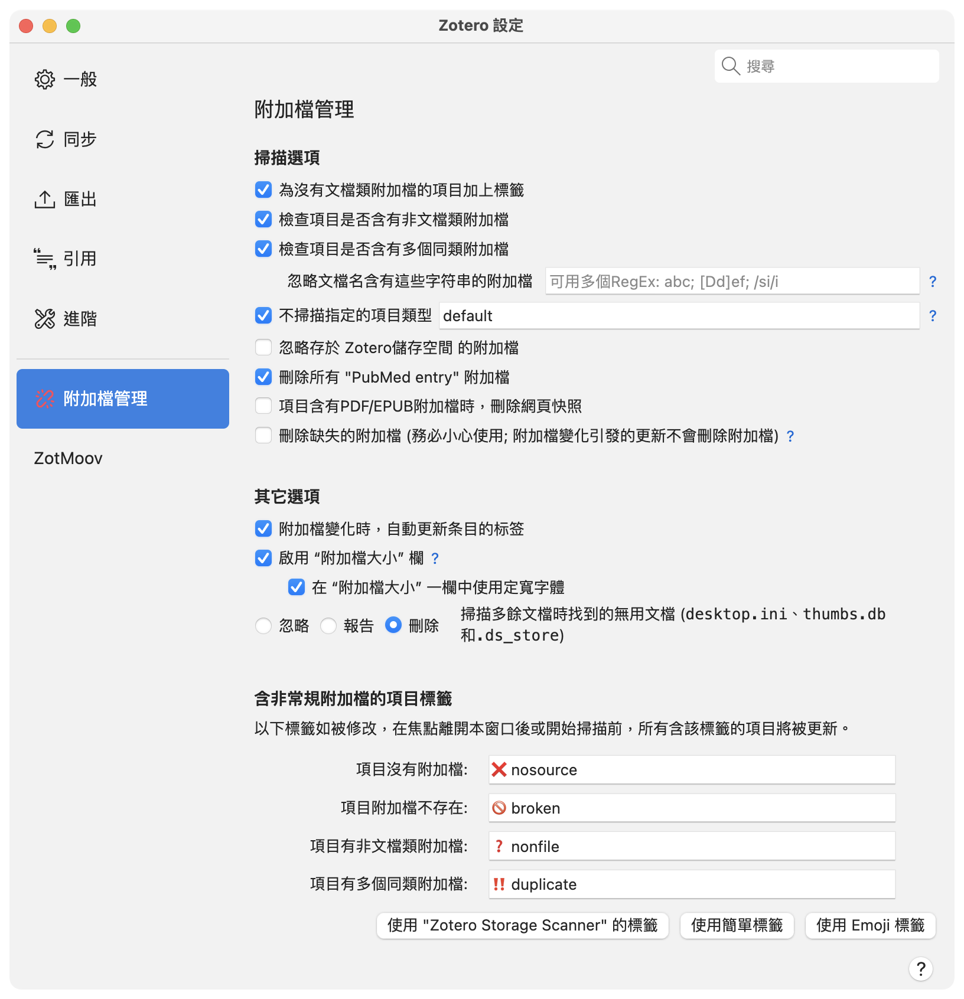

附加檔掃描器設定
=======

[English ](preference_help.md) | **繁體中文** | [简体中文](preference_help.zh-CN.md)

掃描選項
-------
啓用或禁用特定功能。

### 為沒有文檔類附加檔的項目加上標籤
啓用後，即使項目包含非文檔附加檔，只要沒有文檔附加檔，插件就會為其添加“無附加檔”標籤。

### 檢查項目是否含有非文檔類附加檔
啓用後，插件會為包含非文檔附加檔的項目添加“非文檔附加檔”標籤。Zotero 項目可以包含保存元數據的非文檔附加檔。

### 檢查項目是否含有多個同類附加檔
啓用後，如果一個項目包含兩個或以上具有相同內容類型（content type）的附加檔，插件會為其添加“重復附加檔”標籤。內容類型類似於 MIME type，主要由文檔擴展名決定。例如，包含兩個 PDF 附加檔的項目會被視為存在重復附加檔；而同時包含一個 PDF 和一個 .xlsx 附加檔的項目則不會。

#### 忽略文檔名含有這些字符串的附加檔
文檔名匹配這些規則的附加檔將在重復附加檔檢查時被忽略。多個規則請使用分號（`;`）分隔。程序會自動去除首尾空格並轉換為正則表達式（RegEx）。

範例：
- `abc; [dD]ef`：匹配包含“abc”、“def”或“Def”的文檔名，區分大小寫。
- `abc/i; def`：匹配包含“abc”（不區分大小寫）或“def”（區分大小寫）的文檔名。
- `/ abc; def`：匹配包含“ abc”或“def”的文檔名，區分大小寫。

### 不掃描指定的項目類型
每個 Zotero 項目都有一個關聯的項目類型（item type）。某些項目類型可能包含 URL，但沒有附加檔。本字段用於指定在檢查時排除的項目類型，以逗號分隔。

如果未設置，則默認為 `default`，對應：
- `annotation, attachment, note, blogPost, computerProgram, email, forumPost, instantMessage, podcast, radioBroadcast, tvBroadcast, webpage`

請使用 Zotero 的內部項目類型名稱，並且不要包含空格。更多信息請參閱[Zotero官方文檔](https://www.zotero.org/support/kb/item_types_and_fields)。
- 一般不建議排除：`book`, `bookSection`, `conferencePaper`, `document`, `journalArticle`, `manuscript`, `preprint`, `report`, `standard`, `thesis`
- 可以排除，但通常不建議排除：`bill`, `case`, `dictionaryEntry`, `encyclopediaArticle`, `hearing`, `interview`, `letter`, `magazineArticle`, `newspaperArticle`, `patent`, `statute`
- Zotero 內部使用的類型：`annotation`, `attachment`, `note`
- 通常關聯本地或外部數據的類型：`artwork`, `audioRecording`, `dataset`, `film`, `map`, `presentation`, `videoRecording`
- 通常關聯在線內容的類型：`blogPost`, `computerProgram`, `email`, `forumPost`, `instantMessage`, `podcast`, `radioBroadcast`, `tvBroadcast`, `webpage`

範例：
- `default`：不檢查 Zotero 內部使用的項目類型以及通常關聯在線內容的項目類型。
- `webpage, dictionaryEntry`：不檢查引用網頁或詞典項目的項目。

### 忽略存於 Zotero儲存空間 的附加檔
Zotero Storage 中的部分附加檔採用按需下載方式，從雲端存儲獲取。啓用此選項後，這些附加檔不會因尚未下載而被標記為損壞附加檔。

### 刪除所有 "PubMed entry" 附加檔
啓用後，插件會刪除所有名稱為“PubMed entry”的非文檔附加檔。這類附加檔通常由 Zotero 在導入 PubMed 或部分期刊文獻時自動創建。

### 項目含有PDF/EPUB附加檔時，刪除網頁快照
從網頁創建項目時，即使檢測到 PDF 文檔，Zotero 仍可能根據“常規”設置自動保存網頁快照。啓用此選項後，插件會刪除包含 PDF 附加檔項目中的網頁快照。

### 刪除缺失的附加檔
啓用後，項目中的缺失附加檔將被刪除。此操作不會對文檔系統中的實際文檔進行任何修改。

> [!CAUTION]
> 雖然“刪除缺失附加檔”功能不會刪除任何文檔，並且損壞的附加檔仍可從回收站恢復，但如果文檔同步落後於文庫同步，可能會導致嚴重問題。 
> 此選項會在每次啓動 Zotero 時自動重置。

其他選項
-------

### 附加檔變化時，自動更新項目的標籤
啓用後，每當項目或附加檔被添加到文庫或從文庫中刪除時，插件都會自動執行所有已啓用的檢查項目，但不包括“刪除缺失附加檔”。

### 啟用 “附加檔大小” 欄
啓用後（默認開啓），“附加檔大小”列可用於查看和按附加檔大小排序項目。由於這些信息不會保存在數據庫中，而是需要實時從磁盤讀取，因此關閉此功能可以減少不必要的磁盤訪問。

如果不需要該列，建議關閉此功能。特別是因為 Zotero 會加載所有列的數據，即使該列當前未顯示。

#### 在 “附加檔大小” 一欄中使用等寬字體
項目列表默認使用比例字體顯示，這會導致數字無法對齊，不利於比較。啓用此選項後，“附加檔大小”列將使用等寬字體（monospace），以提高可讀性和對齊效果。

### 忽略／報告／刪除無用文檔
掃描“附加檔根目錄”時，插件會查找未與任何 Zotero 項目關聯的孤立文檔（orphan files）。對於這些垃圾文檔，插件可以選擇：
- 忽略；
- 將其列入孤立文檔報告；
- 直接從文檔系統刪除。

含非常規附加檔的項目標籤
-------

用於自定義標籤名稱。修改標籤後，當設置窗口失去焦點或執行新的掃描時，現有項目中的舊標籤會自動更新為新的標籤。

點擊下方三個按鈕之一可使用預設標籤。

|                       | “Zotero Storage Scanner” 標籤      | 簡單標籤    | Emoji 標籤   |
| --------------------: | ---------------------------------- | ----------- | ------------ |
| 無附加檔               | #nosource                          | #nosource   | ❌ nosource  |
| 缺失附加檔             | #broken_attachments                | #broken     | 🚫 broken    |
| 非文檔附加檔           | #non_file_attachments              | #nonfile    | ❓ nonfile   |
| 重復附加檔             | #multiple_attachments_of_same_type | #duplicate  | ‼️ duplicate |